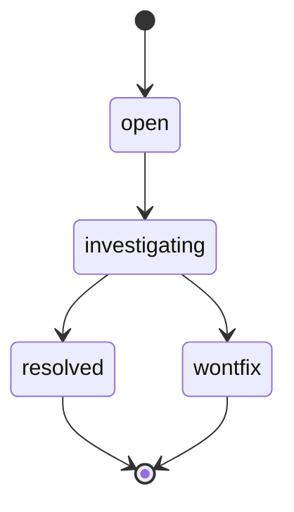

# windhawk-themes — 🐛 Bug Tracker

> 🐛 **Living Source of Truth**: Active tracking ledger for open bugs, quirks, external limitations, and resolution history for **windhawk-themes**.
> Pair with [`ROADMAP.md`](./ROADMAP.md) (direction), [`PLAN.md`](./PLAN.md) (sprints), and [`TODO.md`](./TODO.md) (tasks).

> [!IMPORTANT]
> All known bugs are listed here. AI agents are strictly required to update this page **before** working on any new bug fixes or features and keep it synchronized.

---

## 📜 Tracking Rules

- **100% Active Direction Accuracy (Root & Archives)**: `BUGS.md` and `.github/BUGS-ARCHIVE.md` must reflect the 100% current, active direction of all projects with zero contradictions. Immediately update or remove any quirk or bug entry superseded by a new architectural decision.
- **Zero External Mentions**: Never directly mention by name any external, third-party, or deleted projects or repositories.
- **No Typo Duplication**: When recording user reports, clean and fix all typos to preserve professional quality.
- **Explicit Project Tagging**: Every quirk, open bug, and resolved bug entry header MUST be explicitly prefixed with its current project name and repository path (`[windhawk-themes] (windhawk-themes): {{BUG_TITLE}}`).
- **Bare Minimal Root & Normalized Archive**: Keep `BUGS.md` focused on active issues and current architectural invariants; move detailed post-mortems of resolved bugs to `.github/BUGS-ARCHIVE.md`.

---

## 📖 Legend

### 🚦 Status
- ⚠️ **open** — reproducible, needs fixing *(Include steps to reproduce, expected vs actual behavior).*
- 🚧 **investigating** — repro/root-cause in progress *(Active investigation; must reference an open bug).*
- 🚫 **wontfix** — accepted limitations *(Features/quirks that cannot be altered without platform trade-offs).*
- ✅ **resolved** — verified and fixed *(Moved to closed with release version or commit hash).*

### 🚨 Severity
- 🔴 **Critical**: Bugs that cause shell/app crashes, data loss, or total unreadability.
- 🟠 **High**: Major bugs that significantly impact usability, aesthetics, or state synchronization.
- 🟡 **Medium**: Bugs affecting minor visual alignments, non-critical state transitions, or fallbacks.
- 🟢 **Low**: Minor warnings, duplicate selectors, or non-visual cosmetic quirks.

---

## 🔄 Bug Lifecycle

---

## 🚫 Known Quirks & External Limitations (wontfix bucket)

- 🔒 **[windhawk-themes] {{QUIRK_1_TITLE}}**: {{QUIRK_1_DESCRIPTION}}
- 🔒 **[windhawk-themes] {{QUIRK_2_TITLE}}**: {{QUIRK_2_DESCRIPTION}}

---

## 💡 Explicitly Not Bugs

- 💡 **[windhawk-themes] {{NON_BUG_1_TITLE}}**: {{NON_BUG_1_DESCRIPTION}}

---

## ⚠️ Active & Open Bugs

### 2026-10-19 — [windhawk-themes] (windhawk-themes): {{BUG_TITLE}}
- **Project Identifier:** `[windhawk-themes]`
- **Repository Path:** `windhawk-themes`
- **Severity**: {{SEVERITY_LEVEL}}
- **Status**: ⚠️ open
- **Scope / Affected Component**: `{{AFFECTED_FILE_OR_SUBSYSTEM}}`
- **GitHub Issue**: [{{ISSUE_NUMBER}}]({{ISSUE_LINK}}) *(if applicable)*
- **Reported Issue**: {{USER_OR_MAINTAINER_REPORT}}
- **Root Cause**: {{TECHNICAL_ROOT_CAUSE}}
- **Proposed / Applied Fix**: {{FIX_DETAILS}}

---

## ✅ Closed & Resolved Bugs

### 2026-10-19 — [windhawk-themes] (windhawk-themes): {{RESOLVED_BUG_TITLE}}
- **Project Identifier:** `[windhawk-themes]`
- **Repository Path:** `windhawk-themes`
- **Severity**: {{SEVERITY_LEVEL}}
- **Status**: ✅ resolved (fixed in {{VERSION_OR_COMMIT}})
- **Root Cause**: {{ROOT_CAUSE_EXPLANATION}}
- **Fix**: {{APPLIED_FIX_EXPLANATION}}

---

## 🔖 Metadata

- **Project**: windhawk-themes
- **Tracking Mode**: {{SEMVER_OR_MILESTONES}}
