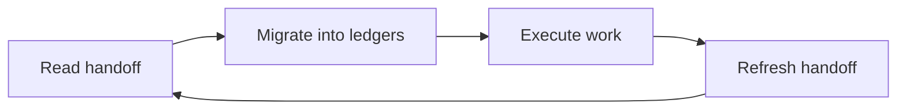

# HANDOFF.md — windhawk-themes Session Handoff

**Last updated:** 2026-10-19
**Current session status:** Initialized · 0 open workstreams
**Project:** windhawk-themes
**Root:** windhawk-themes

> Permanent, git-tracked session-state ledger. Maintained **incrementally** — refresh at every
> workstream state change, fully rewrite at session end / soft-target posture. New session: read
> this file right after `AGENTS.md`, migrate every item into `ROADMAP.md` / `PLAN.md` /
> `TODO.md` / `BUGS.md`, then **refresh this file** (migrated-only state collapses to one-line
> delivered notes). **Never delete it.** See `.agents/rules/session-handoff.md`.

The session cycle every agent follows:

---

## 1) <Workstream name — with project tag> (<status: In Progress | Blocked | Delivered>)
- **State:** <one line: what is true right now>
- **Delivered:** <concise bullets with exact file paths — completed work only>
- **Next tasks:**
  - [ ] <exact next action — file path + what changes + acceptance criteria>
  - [ ] <follow-up task>
- **Ledgers:** `TODO.md` (<item id>), `PLAN.md` (<sprint/workstream id>) — update if missing

---

## 2) <Next workstream — with project tag> (<status>)
- **State:** …
- **Delivered:** …
- **Next tasks:**
  - [ ] …
- **Ledgers:** …

---

## N) Shell / Tooling Notes
- Non-interactive shell policy active (no pagers/editers, fail-fast); use OpenCode Read/Write/Edit for files.
- <disabled tools, experimental flags, environment quirks — only what is NOT discoverable from the repo>

---

## Quick Resume Checklist (New Session)
1. Read `AGENTS.md`
2. Read this file immediately, then `ROADMAP.md` → `PLAN.md` → `TODO.md` → `BUGS.md`
3. Migrate this file's open items into the ledgers, then refresh it (never delete)
4. Open <specific design/source files needed to continue>
5. Resume at the first unchecked `TODO.md` item
6. Run the context-pressure scoreboard at every checkpoint (`session-handoff.md`) — never wait
   for the user to flag a limit
