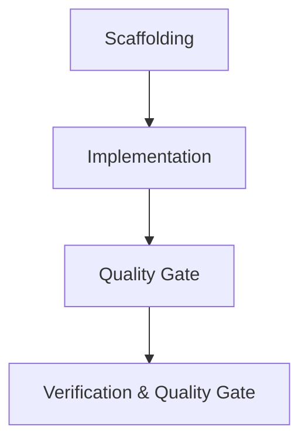

# windhawk-themes — Roadmap & Milestones

> 🗺️ **Living Source of Truth**: Product direction, positioning principles, and milestone delivery history for **windhawk-themes**.
> Pair with [`PLAN.md`](./PLAN.md) (sprint execution), [`TODO.md`](./TODO.md) (task ledger), and [`BUGS.md`](./BUGS.md) (issues and quirks).

> [!IMPORTANT]
> AI agents are strictly required to update this page and related tracking ledgers **before** executing new feature work or bug fixes and keep them synchronized.

---

## 📜 Tracking Rules

- **100% Active Direction Accuracy (Root & Archives)**: `ROADMAP.md`, `PLAN.md`, `TODO.md`, `BUGS.md`, and `.github/*-ARCHIVE.md` must reflect the 100% current, active direction of all projects with zero contradictions. Immediately replace or remove superseded statements across both root and archive files.
- **Zero External Mentions**: Never directly mention by name any external, third-party, or deleted projects or repositories.
- **No Typo Duplication**: When recording user reports or directives, clean and fix all typos to preserve professional quality.
- **Explicit Project Tagging**: Every milestone, sprint, task, or deliverable header and row MUST explicitly include its current project name and repository path (e.g., `[windhawk-themes] (windhawk-themes)`).
- **Bare Minimal Root & Normalized Archive**: Keep `ROADMAP.md` focused on active and upcoming milestones; archive delivered milestone narratives into `.github/ROADMAP-ARCHIVE.md` in normalized format.

---

## 🔭 Vision & Positioning Principles

1. **Core Value Proposition**: {{VISION_STATEMENT}}
2. **Design Principles**:
   - {{PRINCIPLE_1}}
   - {{PRINCIPLE_2}}
   - {{PRINCIPLE_3}}
3. **Non-Goals & Boundaries**:
   - {{NON_GOAL_1}}
   - {{NON_GOAL_2}}

---

## 🗺️ Milestone Overview

| # | Milestone | Scope / Repository | Status | Release / Target | Focus |
|---|---|---|---|---|---|
| **M1** | [windhawk-themes] {{MILESTONE_1_NAME}} | `windhawk-themes` | ✅ Shipped | {{TAG_OR_COMMIT}} | {{SUMMARY}} |
| **M2** | [windhawk-themes] {{MILESTONE_2_NAME}} | `windhawk-themes` | 🚀 Active | {{TARGET_DATE_OR_VERSION}} | {{SUMMARY}} |
| **M3** | [windhawk-themes] {{MILESTONE_3_NAME}} | `windhawk-themes` | ⏳ Planned | {{TARGET}} | {{SUMMARY}} |

---

## 🚀 Active Milestones

### [windhawk-themes] (windhawk-themes) — Milestone M1: Foundation & Scaffolding

#### Detailed Deliverables

- 🎯 **[windhawk-themes] Project Scaffolding**: Establish initial project files and local agents.
- 🎯 **[windhawk-themes] {{DELIVERABLE_2_TITLE}}**: {{DELIVERABLE_2_DESC}}
- 🎯 **[windhawk-themes] {{DELIVERABLE_3_TITLE}}**: {{DELIVERABLE_3_DESC}}

---

## 🔮 Planned & Future Milestones

### [windhawk-themes] (windhawk-themes) — Milestone {{NEXT_ID}}: {{NEXT_SCOPE_SUMMARY}}
- ⏳ **Backlog Candidates**: {{CANDIDATE_ITEMS}}

---

## 📌 Historical Milestones & Shipped Releases

### [windhawk-themes] (windhawk-themes) — Milestone {{PREV_MILESTONE_ID}}: {{PREV_MILESTONE_NAME}} ({{RELEASE_VERSION_OR_TAG}})
- {{COMPLETED_ITEM_1}}
- {{COMPLETED_ITEM_2}}

---

## 🔖 Metadata

- **Project / Scope**: {{PROJECT_NAME_AND_TYPE}}
- **Tracking Mode**: {{SEMVER_OR_MILESTONES}}
- **Governance**: Governed by `.agents/` rules and organization handoff contracts.
